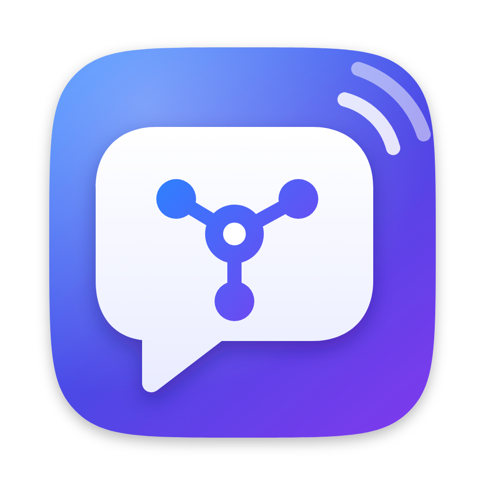
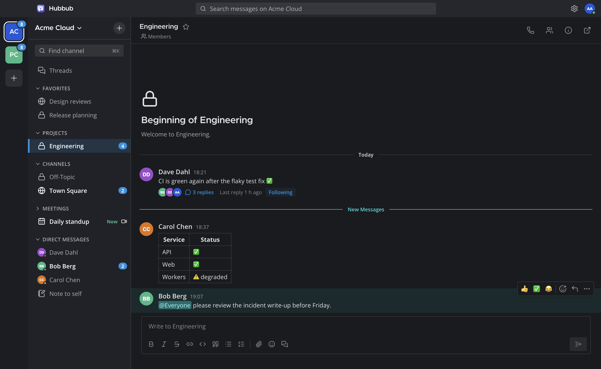

<p align="center">
  
</p>

<h1 align="center">Hubbub</h1>

<p align="center">
  A Mattermost-style desktop client for <a href="https://nextcloud.com/talk/">Nextcloud Talk</a>, with multi-server support.<br/>
  macOS · Windows · Linux
</p>


## Features

- **Many servers, one app.** Add as many Nextcloud servers as you like. They appear in a server rail on the
  left with unread and mention badges, and you switch with <kbd>Ctrl/⌘</kbd>+<kbd>1…9</kbd>.
- **A familiar sidebar.** Favorites, your own categories, Channels and Direct Messages. Drag conversations
  between categories and sort each category alphabetically or by recent activity. Custom categories are
  stored on the server (Talk _conversation tags_) when available, so they match the Talk web app.
- **Threads.** Replies are collapsed into threads like in Mattermost, with a reply count under the original
  message. Follow threads, and see the ones you follow (including unread ones) in the **Threads** view.
- **Meetings.** Conversations the Calendar creates for events get their own Meetings category with the
  meeting time; past meetings tidy themselves away. You can mark other conversations as meetings too.
- **Chat.** Markdown, code blocks, tables, @mentions with autocomplete, emoji reactions, quote replies,
  editing (↑ edits your last message) and deleting.
- **Files.** Upload with the paperclip, drag and drop, or paste. Images show inline previews.
- **Find anything.** <kbd>Ctrl/⌘</kbd>+<kbd>K</kbd> jumps to any conversation or person on any server, with
  Unread and Meetings filters; the search bar searches messages.
- **Mark as unread** from any message (or <kbd>Alt</kbd>+click), and drafts are kept across restarts.
- **Notifications.** Desktop notifications for direct messages and mentions, which respect each
  conversation's notification level, plus dock/taskbar badges.
- **Themes.** Denim, Sapphire, Quartz, Indigo and Onyx, or follow the system's light/dark setting.
- **Runs in the background.** Tray icon on Windows and Linux, and optional start at login.
- **Secure by default.** Browser-based login with app passwords stored in the OS keychain (see [SECURITY.md](SECURITY.md)).
  Servers with self-signed or company-internal certificates work after you review and trust the certificate.



## Requirements

- A Nextcloud server with the **Talk** app enabled.
- Some features depend on your Talk version. Hubbub detects what your server supports:

| Feature                                     | Talk version                               |
| ------------------------------------------- | ------------------------------------------ |
| Chat, reactions, favorites, mentions, files | 15+                                        |
| Editing messages                            | 18+                                        |
| Threads and the Threads view                | 22+ (Nextcloud 32)                         |
| Server-synced custom categories             | 24+; older servers keep categories locally |

## Install

Download the installer for your system. The links always point to the latest release; older versions and
release notes are on the [Releases page](https://github.com/tobberydberg/hubbub/releases).

| Platform                            | Download                                                                                                                                                                                                      |
| ----------------------------------- | ------------------------------------------------------------------------------------------------------------------------------------------------------------------------------------------------------------- |
| macOS, Apple Silicon (M1 and later) | [Hubbub-mac-arm64.dmg](https://github.com/tobberydberg/hubbub/releases/latest/download/Hubbub-mac-arm64.dmg)                                                                                                  |
| macOS, Intel                        | [Hubbub-mac-x64.dmg](https://github.com/tobberydberg/hubbub/releases/latest/download/Hubbub-mac-x64.dmg)                                                                                                      |
| Windows (x64)                       | [Hubbub-Setup-x64.exe](https://github.com/tobberydberg/hubbub/releases/latest/download/Hubbub-Setup-x64.exe)                                                                                                  |
| Windows (ARM)                       | [Hubbub-Setup-arm64.exe](https://github.com/tobberydberg/hubbub/releases/latest/download/Hubbub-Setup-arm64.exe)                                                                                              |
| Linux AppImage (x64 / ARM)          | [x86_64](https://github.com/tobberydberg/hubbub/releases/latest/download/Hubbub-linux-x86_64.AppImage) · [arm64](https://github.com/tobberydberg/hubbub/releases/latest/download/Hubbub-linux-arm64.AppImage) |
| Debian, Ubuntu (x64 / ARM)          | [amd64.deb](https://github.com/tobberydberg/hubbub/releases/latest/download/Hubbub-linux-amd64.deb) · [arm64.deb](https://github.com/tobberydberg/hubbub/releases/latest/download/Hubbub-linux-arm64.deb)     |
| Fedora, openSUSE (x64)              | [x86_64.rpm](https://github.com/tobberydberg/hubbub/releases/latest/download/Hubbub-linux-x86_64.rpm)                                                                                                         |

> **Unsigned builds:** Hubbub isn't code-signed yet, so your system asks before running it the first time.
>
> - **macOS:** open Hubbub once and close the warning, then go to **System Settings → Privacy & Security**,
>   scroll down and click **Open Anyway** next to the message about Hubbub. (Or run
>   `xattr -dr com.apple.quarantine /Applications/Hubbub.app` in Terminal.) Updates aren't installed
>   automatically on macOS until the app is signed; Hubbub tells you when a new version is out.
> - **Windows:** choose **More info → Run anyway** in the SmartScreen prompt.

Then click **Add a server**, enter your Nextcloud address, and approve access in the browser window that opens.
If your server does not allow the browser login, use **Sign in with an app password instead** (create one under
_Personal settings → Security → Devices & sessions_).

## Keyboard shortcuts

| Shortcut                                        | Action                            |
| ----------------------------------------------- | --------------------------------- |
| <kbd>Ctrl/⌘</kbd>+<kbd>K</kbd>                  | Find a conversation on any server |
| <kbd>Ctrl/⌘</kbd>+<kbd>1…9</kbd>                | Switch server                     |
| <kbd>Alt</kbd>+<kbd>↑/↓</kbd>                   | Previous/next conversation        |
| <kbd>Alt</kbd>+<kbd>Shift</kbd>+<kbd>↑/↓</kbd>  | Previous/next unread conversation |
| <kbd>Ctrl/⌘</kbd>+<kbd>Shift</kbd>+<kbd>F</kbd> | Search messages                   |
| <kbd>Ctrl/⌘</kbd>+<kbd>N</kbd>                  | New direct message                |
| <kbd>↑</kbd> in an empty message box            | Edit your last message            |
| <kbd>Ctrl/⌘</kbd>+<kbd>,</kbd>                  | Settings                          |

## Not yet supported

- **Voice and video calls.** The call button opens the conversation in your browser for now.
- Polls, voice messages and shared locations are shown as links or files, not as rich widgets.
- Typing indicators and read receipts.

## Development

You need Node.js 22.12 or newer.

```bash
npm install
npm run mock-server   # optional: a fake Talk server on http://localhost:8686 (login "alice", any password)
npm run dev           # start the app with hot reload
```

See [CONTRIBUTING.md](CONTRIBUTING.md) for the architecture, checks and release process.

## Privacy

Hubbub talks only to the Nextcloud servers you add, plus GitHub to check for updates. There is no telemetry or
analytics. Your app passwords are encrypted with the operating system's keychain (Electron `safeStorage`), and
signing out of a server revokes its app password. Drafts and preferences stay on your computer. On Linux,
Chromium downloads spell-check dictionaries from Google the first time they are needed; turn off
**Settings → Desktop → Check spelling** to avoid that.

## Disclaimer

Hubbub is an independent open-source project. It is not affiliated with or endorsed by Nextcloud GmbH or
Mattermost, Inc. "Nextcloud" and "Mattermost" are trademarks of their respective owners.

## License

[Apache License 2.0](LICENSE)
